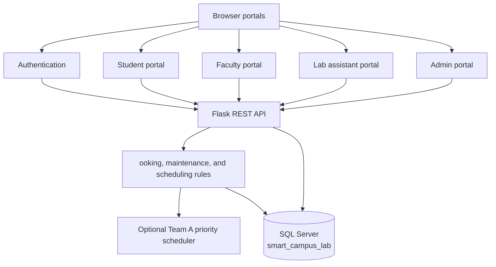

# Smart Campus Lab & Resource Optimizer

_A role-based campus laboratory booking and resource-management system built with Flask, SQL Server, HTML, CSS, and JavaScript._

---

##  Project overview

Smart Campus Lab & Resource Optimizer helps a college manage laboratory availability, equipment resources, bookings, maintenance requests, notifications, and role-specific workflows from one web application.

The application includes separate experiences for **students**, **faculty**, **lab assistants**, and **administrators**. A Flask API provides the business logic and SQL Server stores operational data such as users, labs, resources, bookings, schedules, maintenance, notifications, audit logs, and scheduling decisions.

>  **Development status:** This is a student mini-project intended for local demonstration and academic evaluation. Review authentication, authorization, CORS, input validation, secret management, and deployment hardening before using it with real users or production data.

## Features

| Area | Capabilities |
| --- | --- |
| Authentication | Login, registration, logout, password reset, role selection, password hashing for application-created accounts |
| Student portal | Browse labs and resources, request lab bookings, view booking status, report maintenance issues, view notifications |
| Faculty portal | Request lab access and receive higher scheduling priority than student requests |
| Lab assistant portal | Review lab/resource status, manage operational maintenance workflows, and inspect daily schedules |
| Admin portal | Manage labs, resources, maintenance, users, booking approvals/rejections, activity logs, and reports |
| Scheduling | Booking conflict checks, availability checks, approval workflow, time allocation, and optional Team A priority scheduling |
| Database | SQL Server schema and seed script for roles, users, labs, resources, bookings, schedules, maintenance, logs, and notifications |

## Architecture

The project is a static frontend served separately from a Flask API. The API connects to SQL Server through `pyodbc`; the optional Team A integration is used when its package is available.



### Repository structure

```text
.
├── backend/
│   ├── app.py                         # Flask API and route handlers
│   ├── database.py                    # SQL Server connection helpers
│   ├── team_a_service.py              # Optional priority-scheduler adapter
│   └── requirements.txt               # Python dependencies
├── css/                               # Shared and role-specific stylesheets
├── js/                                # Frontend API, auth, booking, and portal logic
├── pages/                             # Additional role portal pages
├── resources/                         # Shared visual resources
├── scratch/                           # Manual diagnostics and end-to-end scripts
├── index.html                         # Login page
├── admin.html                         # Admin portal entry point
├── lab-assistant.html                 # Lab assistant portal entry point
├── faculty.html                       # Faculty portal entry point
├── student.html                       # Student portal entry point
├── smart_campus_lab_SQLServer_SSMS_FIXED.sql
├── START_BACKEND.bat                  # Windows backend launcher
└── .env.example                       # Database configuration template
```

## Quick start

### Prerequisites

| Requirement | Version or note |
| --- | --- |
| Python | 3.10 or newer recommended |
| Microsoft SQL Server | SQL Server Express or another compatible edition |
| SQL Server Management Studio | Required to run the supplied `.sql` setup script |
| SQL Server ODBC driver | ODBC Driver 17 or 18 recommended |
| Browser or VS Code Live Server | Used to serve the frontend |

### 1. Clone and enter the repository

```bash
git clone https://github.com/<your-account>/<your-repository>.git
cd Smart_Campus_Lab_and_Resource_Optimizer
```

### 2. Create the Python environment

PowerShell:

```powershell
python -m venv backend\.venv
backend\.venv\Scripts\Activate.ps1
python -m pip install --upgrade pip
pip install -r backend\requirements.txt
```

If PowerShell blocks activation, run the backend using `backend\.venv\Scripts\python.exe` directly or adjust the execution policy for your user account.

### 3. Create and seed the database

1. Start SQL Server.
2. Create an empty database named `smart_campus_lab` if it does not already exist:

   ```sql
   CREATE DATABASE smart_campus_lab;
   ```

3. Open `smart_campus_lab_SQLServer_SSMS_FIXED.sql` in SQL Server Management Studio.
4. Update the `USE smart_campus_lab` target if your database has a different name.
5. Execute the script.
6. Confirm that the schema and seed data were created successfully.

The script recreates the `smart_campus_lab` schema objects and inserts role records, sample users, labs, resources, schedules, and booking data. It is a development seed script, not a production migration system. The script drops and recreates its managed tables, so do not run it against a database containing data you need to preserve.

### 4. Configure the database connection

Copy `.env.example` to `.env` for reference, then expose the values in the shell that starts Flask. The current code reads environment variables directly; it does not load `.env` automatically.

For Windows integrated authentication:

```powershell
$env:DB_SERVER='.\SQLEXPRESS'
$env:DB_NAME='smart_campus_lab'
$env:DB_USER=''
$env:DB_PASSWORD=''
```

For SQL Server authentication:

```powershell
$env:DB_SERVER='localhost'
$env:DB_NAME='smart_campus_lab'
$env:DB_USER='your_sql_user'
$env:DB_PASSWORD='your_sql_password'
$env:DB_DRIVER='ODBC Driver 18 for SQL Server'
```

### 5. Start the Flask API

From the repository root:

```powershell
backend\.venv\Scripts\python.exe backend\app.py
```

The API listens on `http://127.0.0.1:5000`. The Windows shortcut `START_BACKEND.bat` can also be used after creating `backend\.venv`.

Verify the API:

```powershell
Invoke-WebRequest http://127.0.0.1:5000/api/health
```

### 6. Serve the frontend

Use VS Code Live Server on `index.html`, or run a simple local server from the repository root:

```powershell
python -m http.server 5500
```

Open `http://127.0.0.1:5500/index.html` and keep the Flask API running in a separate terminal.

The frontend defaults to `http://127.0.0.1:5000/api`. To use another API host, define `window.SMART_CAMPUS_API_URL` before loading the frontend scripts.

## Demo accounts

The SQL seed script contains development-only sample accounts for all four roles. Read the account rows in `smart_campus_lab_SQLServer_SSMS_FIXED.sql` after importing the database.

> **Do not reuse seeded passwords in a public or production deployment.** Replace the sample credentials, remove unnecessary personal-looking seed data, and use a controlled account-provisioning process before publishing a live instance.

## 📡 API overview

The API is rooted at `http://127.0.0.1:5000/api`.

| Group | Representative endpoints | Purpose |
| --- | --- | --- |
| Diagnostics | `GET /health`, `GET /db-test` | Check API and SQL Server connectivity |
| Authentication | `POST /auth/login`, `POST /auth/register`, `POST /auth/logout`, `POST /auth/forgot-password` | Manage user access |
| Labs and resources | `GET /labs`, `GET /resources` | Read laboratory and equipment availability |
| Maintenance | `GET /maintenance`, `POST /maintenance`, `POST /maintenance/<id>/start`, `POST /maintenance/<id>/complete` | Report and process issues |
| Bookings | `GET /bookings/check-availability`, `POST /bookings`, `GET /bookings/my` | Create and inspect booking requests |
| Booking decisions | `GET /bookings/pending`, `POST /bookings/<id>/approve`, `POST /bookings/<id>/reject` | Admin approval workflow |
| Notifications | `GET /notifications`, `POST /notifications/<id>/read` | Read and acknowledge notifications |
| Administration | `GET /admin/dashboard-stats`, `GET /admin/users`, `GET /admin/reports` | Admin dashboard and reporting |
| Recommendations | `GET /recommendation`, `GET /recommendations` | Lab recommendation responses |

The complete route implementation is in `backend/app.py`; `js/api.js` is the frontend API client.

## 🧪 Testing and diagnostics

The `scratch/` directory contains manual verification scripts. Most scripts require a running SQL Server database and the seeded schema.

```powershell
backend\.venv\Scripts\python.exe scratch\test_api_suite.py
backend\.venv\Scripts\python.exe scratch\verify_system.py
```

The most useful first checks are:

1. `GET /api/health`
2. `GET /api/db-test`
3. Login with one seeded development account
4. Check labs and resources
5. Create and review a booking request

## 🔧 Troubleshooting

### `Cannot connect to the backend server`

Confirm that `backend\app.py` is running on port `5000` and that the browser is loading the frontend from a local HTTP server rather than opening the HTML file directly.

### `pyodbc.InterfaceError` or missing ODBC driver

Install a supported Microsoft SQL Server ODBC driver and set `DB_DRIVER` to its exact installed name. The database helper checks common driver names automatically but falls back to ODBC Driver 18.

### `Login failed for user`

Check `DB_SERVER`, `DB_NAME`, `DB_USER`, and `DB_PASSWORD`. For Windows authentication, leave `DB_USER` and `DB_PASSWORD` empty and ensure the Windows account has access to the database.

### `ModuleNotFoundError: team_a`

The optional Team A scheduler is not included in this repository. The adapter reports `UNAVAILABLE` and the rest of the API can continue to run. Install or add the Team A package only if priority scheduling integration is required.

### Frontend shows stale or missing pages

Serve the repository root with Live Server or `python -m http.server`; do not open the HTML files with a `file://` URL. Confirm that the relative `css/` and `js/` paths resolve from the selected page.

## Contributing

Read [CONTRIBUTING.md](CONTRIBUTING.md) before making changes. At minimum:

1. Create a feature branch from `main`.
2. Keep database credentials and local configuration out of commits.
3. Update the SQL script or documentation when schema behavior changes.
4. Run the relevant diagnostic scripts against a local database.
5. Describe setup, testing, and known limitations in the pull request.

